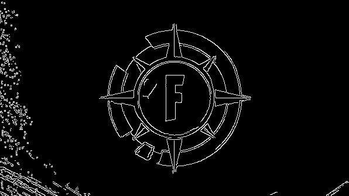
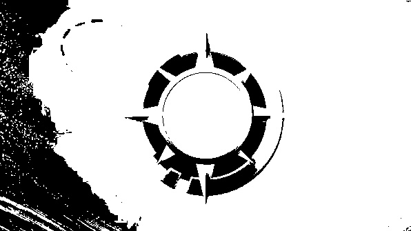

# UIII Act 5 OpenCV Practica Alumno
# Dorado Luna Caleb Joshua NC = 0039
# 20 de Noviembre del 2026

# Fuente/Link original del codigo
[Sitio original](https://bhavikjikadara.medium.com/image-processing-using-opencv-a-step-by-step-guide-e589b0acbbf3)

## El procesamiento de imágenes es fundamental en campos modernos como la IA, la visión artificial y la robótica. OpenCV, una potente biblioteca de código abierto, permite a los desarrolladores gestionar tareas complejas de procesamiento de imágenes con facilidad. Este blog te guiará a través de técnicas esenciales de procesamiento de imágenes con Python, abarcando desde la lectura y visualización de imágenes, la conversión de espacios de color y el redimensionamiento, hasta tareas más avanzadas como la detección de bordes, la detección de contornos y la umbralización. Con ejemplos prácticos, aprenderás a manipular y mejorar imágenes sin esfuerzo.

# Imagen Original 0039

# Escala de Grises

# Imagen Redimensionada

# Imagen Rotada

# Desenfoque Gaussiano

# Detección de Bordes (Canny)

# Imagen con Formas y Texto

# Umbralización Binaria

# Deteccion de contornos

